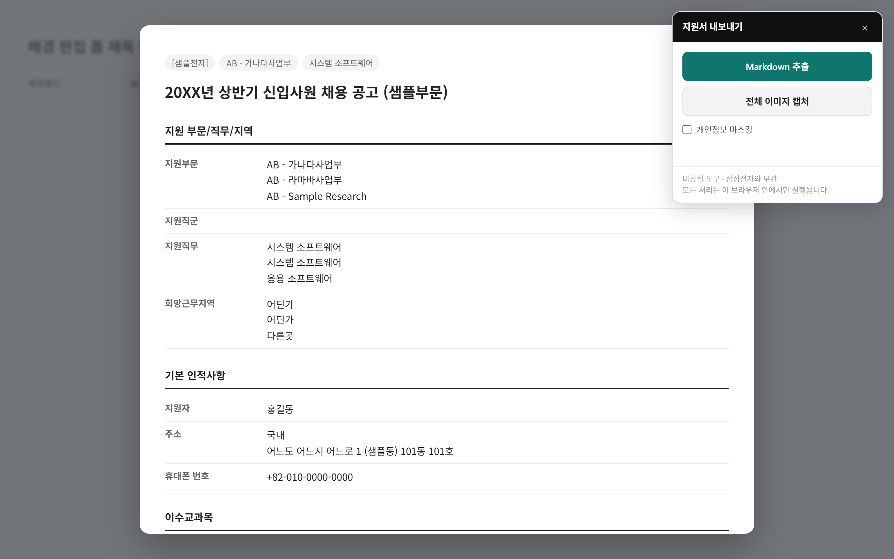

<div align="center">

# 📄 지원서 내보내기

**Samsung Careers Resume Exporter**

삼성 커리어스에 작성한 **내 지원서**를 잘 정리된 Markdown 문서와<br>
잘리지 않은 전체 이미지로 저장하는 북마클릿입니다. 즐겨찾기 하나로 동작합니다.

[](https://github.com/lisuugi/sc-resume-exporter/actions/workflows/test.yml)
[](https://lisuugi.github.io/sc-resume-exporter/)
[](LICENSE)


[**설치하기**](https://lisuugi.github.io/sc-resume-exporter/) ·
[사용법](#-빠른-시작) ·
[출력 예시](examples/sample-output.md) ·
[파싱 설계 문서](docs/PARSING.md) ·
[이슈 제보](https://github.com/lisuugi/sc-resume-exporter/issues)



<sub>데모 화면은 테스트용 가공 데이터로 만든 것입니다.</sub>

</div>

> [!IMPORTANT]
> **비공식 도구입니다.** 삼성전자 및 삼성 커리어스와 제휴하거나 승인받지 않았습니다.
> 본인이 작성한 지원서를 본인이 내려받는 용도로만 사용하세요.

---

## ✨ 기능

| | |
|---|---|
| 📝 **Markdown 추출** | 화면을 그대로 긁지 않고 문서 구조를 다시 짭니다. front matter, 지망별 표, 정리된 성적표, 문단이 보존된 에세이를 만듭니다. |
| 🖼️ **전체 이미지 캡처** | 세로·가로로 잘려 있던 미리보기를 모두 펼쳐 **JPG 한 장**으로 저장합니다. 성적표 오른쪽 열도 빠지지 않습니다. |
| 🙈 **개인정보 마스킹** | 주소, 연락처, 이메일, 자격번호를 `███`로 가린 사본을 만듭니다. 첨삭을 부탁할 때 쓰세요. |
| 🔒 **완전한 로컬 처리** | 서버도, 저장도, 추적도 없습니다. 모든 처리는 브라우저 안에서 끝납니다. |
| 🪶 **설치 없음** | 확장 프로그램이 필요 없습니다. 즐겨찾기 바에 버튼 하나만 끌어다 놓으면 됩니다. |

## 🚀 빠른 시작

**1. 설치** · [설치 페이지](https://lisuugi.github.io/sc-resume-exporter/)에서 **지원서 내보내기** 버튼을 즐겨찾기 바로 끌어다 놓습니다.

> 즐겨찾기 바가 보이지 않으면 `Ctrl+Shift+B`(Mac은 `⌘+Shift+B`)로 켤 수 있습니다.

**2. 실행** · 삼성 커리어스에 로그인한 뒤 **내 지원서 → 미리보기**를 열고, 즐겨찾기의 **지원서 내보내기**를 클릭합니다.

**3. 저장** · 화면 오른쪽 위 패널에서 **Markdown 추출** 또는 **전체 이미지 캡처**를 누릅니다.

```
삼성 커리어스 로그인 ─▶ 내 지원서 ─▶ [미리보기] ─▶ ★ 지원서 내보내기 ─▶ 📥 .md / .jpg
```

## 🤔 왜 필요한가

지원서 미리보기 창은 화면 캡처가 잘 되지 않습니다. 세 겹으로 잘려 있기 때문입니다.

| 잘림 | 원인 | 결과 |
|---|---|---|
| 세로 | `#formPreview` 가 `position: fixed` | 페이지 스크롤로 전체를 볼 수 없음 |
| 세로 | `.modalBody` 의 `max-height` + `overflow` | 창 안쪽에서만 스크롤됨 |
| 가로 | `.tableWrap` 의 `overflow-x` | **성적표의 취득학점·성적·재수강 여부 열이 사라짐** |

특히 세 번째가 함정입니다. 화면을 이어 붙여 찍어도 성적 열이 통째로 빠진 이미지가 나옵니다.
이 도구는 세 가지를 모두 해제하고 한 장으로 렌더링한 뒤, **끝나면 원래 배치로 되돌립니다.**

## 📄 출력 예시

Markdown은 단순한 텍스트 덤프가 아닙니다. 다시 읽고 가공하기 좋은 구조로 정리합니다.

- 한 줄에 뭉쳐 있던 1·2·3지망을 **지망별 표**로 재구성합니다.
- 이수교과목 표에서 **모든 행이 같은 열**(전공명, 재수강 여부 등)은 표 위 한 줄로 빼고, 전공과 교양은 **별도 표**로 나눕니다.
- 에세이는 **문단 줄바꿈을 보존**해 문항별 소제목 아래에 넣습니다.
- 문서 맨 앞에 공고명과 추출일을 담은 **front matter**를 붙입니다.

<details>
<summary><b>결과물 미리보기</b> (가공 데이터)</summary>

```markdown
---
document_type: 입사 지원서 (Samsung Careers 미리보기 추출본)
recruitment: "20XX년 상반기 신입사원 채용 공고 (샘플부문)"
extracted_at: 2026-09-28
generated_by: sc-resume-exporter v1.0.0
---

## 1. 지원 부문/직무/지역

| 지망 | 지원부문 | 지원직무 | 희망근무지역 |
|---|---|---|---|
| 1 | AB - 가나다사업부 | 시스템 소프트웨어 | 어딘가 |
| 2 | AB - 라마바사업부 | 시스템 소프트웨어 | 어딘가 |

## 3. 이수교과목

과정: 학사 · 전공명: 샘플공학(샘플대-학사-주전공) · 재수강 여부: N

#### 전공 (3과목)

| 수강연도 | 학기 | 과목명 | 취득학점 | 성적 |
|---|---|---|---|---|
| 2020 | 1 | 가전공과목 | 3 | A+ |

## 5. 에세이

### 지원 동기를 기술하십시오.

[첫 번째 소제목]
첫 문단입니다. …
```

전체 예시는 [`examples/sample-output.md`](examples/sample-output.md)에 있습니다.

</details>

## 🔒 개인정보

이 도구는 이름, 주소, 연락처, 학적, 자격번호를 다룹니다. 그래서 설계 단계에서 외부 전송 경로를 만들지 않았습니다.

| 항목 | 내용 |
|---|---|
| **서버** | 없습니다. 네트워크 요청은 이미지 캡처 때 [`html2canvas`](https://html2canvas.hertzen.com/)를 CDN에서 받는 것 하나뿐입니다. Markdown 추출은 네트워크를 쓰지 않습니다. |
| **저장** | 없습니다. 쿠키나 localStorage를 쓰지 않습니다. |
| **추적** | 없습니다. 분석 스크립트가 없습니다. |
| **안내 페이지** | 정적 페이지입니다. 동일 출처 정책 때문에 지원서 내용에 접근할 수 없습니다. |

> [!WARNING]
> 다운로드한 파일에는 개인정보가 그대로 들어 있습니다. **공개된 곳에 올릴 때는 마스킹 옵션을 쓰거나 직접 지우세요.**

## ❓ FAQ

<details>
<summary><b>설치 페이지에서 버튼만 누르면 바로 가져올 수는 없나요?</b></summary>

<br>

불가능합니다. 브라우저의 **동일 출처 정책(Same-Origin Policy)** 때문입니다.
`github.io` 페이지는 `samsungcareers.com`의 화면이나 로그인 세션을 읽을 수 없습니다.
만약 읽을 수 있다면 그것이야말로 심각한 보안 결함입니다.

그래서 추출 코드는 지원서 페이지 **안에서** 실행되어야 하고, 그 코드를 즐겨찾기에 담아 사용자가 직접 실행하는 **북마클릿** 방식을 택했습니다.
코드가 서버를 거치지 않으니 데이터가 새어 나갈 경로도 없습니다.

</details>

<details>
<summary><b>"지원서 미리보기를 찾지 못했습니다"라고 나옵니다</b></summary>

<br>

미리보기 창이 열려 있지 않은 상태입니다. 지원서 화면에서 **미리보기**를 먼저 연 뒤 다시 실행하세요.
미리보기가 열려 있는데도 같은 메시지가 나온다면 사이트 구조가 바뀐 것이니 [이슈](https://github.com/lisuugi/sc-resume-exporter/issues)로 알려 주세요.

</details>

<details>
<summary><b>즐겨찾기로 끌어다 놓기가 안 됩니다</b></summary>

<br>

[설치 페이지](https://lisuugi.github.io/sc-resume-exporter/#fallback) 아래쪽의 **콘솔에 붙여넣어 실행하기**를 쓰세요.
미리보기를 연 상태에서 `F12` → Console 탭에 코드를 붙여넣으면 같은 패널이 뜹니다.
출처를 모르는 코드를 콘솔에 붙여넣는 것은 위험한 습관이니, [`src/exporter.js`](src/exporter.js)를 먼저 읽어 보시길 권합니다.

</details>

<details>
<summary><b>이미지 캡처가 실패하거나 아주 느립니다</b></summary>

<br>

지원서가 길면 렌더링에 수십 초가 걸립니다. 패널에 "렌더링 중"이 보이면 기다려 주세요.
사내망처럼 외부 CDN이 막힌 환경에서는 `html2canvas`를 받지 못해 실패합니다. 이 경우에도 Markdown 추출은 그대로 쓸 수 있습니다.

</details>

## 🛠 개발

```bash
git clone https://github.com/lisuugi/sc-resume-exporter
cd sc-resume-exporter
npm install
npm test                 # 파싱 로직 검증 (jsdom, 38개 검사)
npm run build            # dist/ 재생성 + index.html 에 북마클릿 주입
TARGET=dist npm test     # 최소화된 빌드 결과도 검증
```

```
src/exporter.js       전체 로직. 단일 파일, 런타임 의존성 없음 (ES5)
build.mjs             terser 최소화 → javascript: URL 생성 → index.html 주입
index.html            GitHub Pages 설치 페이지
docs/PARSING.md       파싱 규칙과 그렇게 만든 근거 ← 코드 수정 전 필독
test/fixture.js       실제 DOM 구조를 재현한 픽스처 (내용은 전부 가공 데이터)
test/run.mjs          검증 스위트
scripts/demo.mjs      README 데모 스크린샷 생성 (Playwright)
```

<details>
<summary><b>검증 범위</b></summary>

<br>

픽스처는 실제 페이지에서 확인한 클래스 구조를 그대로 따르며, 다음을 검사합니다.

- 모달 뒤의 편집 폼, 숨김 섹션, 닫힌 모달이 결과에 섞이지 않는지
- 필드명(`h4.dt`)이 소제목으로 잘못 분류되지 않는지
- 다중값 필드가 구분자 없이 붙지 않는지
- 에세이의 문단 줄바꿈이 보존되는지
- 표 셀의 줄바꿈이 표를 깨뜨리지 않는지
- 상수 열 추출과 분류 열 분할이 의도대로 되는지
- 마스킹이 본문을 훼손하지 않는지

</details>

기여는 환영합니다. `src/exporter.js`를 고쳤다면 `npm run build`를 돌려 `dist/`와 `index.html`을 함께 커밋해 주세요. CI가 빌드 결과 누락을 검사합니다.

## ⚠️ 알려진 한계

- **셀 병합(rowspan/colspan)은 지원하지 않습니다.** 열 수가 헤더와 다른 행이 있으면 표 정리를 건너뛰고 원본을 그대로 내보냅니다.
- **첫 행을 헤더로 가정합니다.** 캡션 행이 먼저 나오는 표는 잘못 해석될 수 있습니다.
- **값이 여러 개인 필드는 `|`로 이어 붙입니다.**
- **한 공고에서만 검증했습니다.** 양식이 다르면 어긋날 수 있으니 결과물은 제출 전에 눈으로 확인하세요.

사이트 구조가 바뀌어 동작하지 않으면 [이슈](https://github.com/lisuugi/sc-resume-exporter/issues)로 알려 주세요.

## 📜 라이선스

[MIT](LICENSE)

<sub>이 프로젝트는 삼성전자 및 삼성 커리어스와 무관한 개인 프로젝트입니다. 언급된 상표는 각 소유자의 것입니다.</sub>
